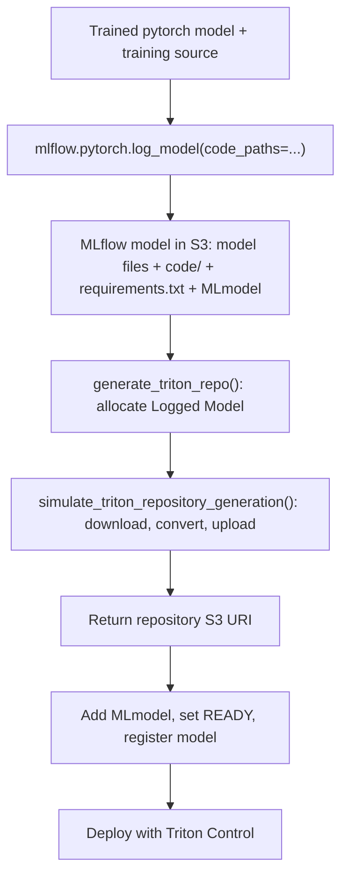

# Iris PyTorch: model, code and requirements

Train an Iris classifier and use `mlflow.pytorch.log_model()` to save its
trained model, training source and automatically inferred model dependencies.
A simulated generator builds an ONNX Triton repository, uploads it once, and
returns its S3 URI. The wrapper completes the Logged Model and registers it;
the deploy step passes the concrete S3 URI to Triton Control.

A small CPU network (`4 → 16 → 3`) trains for 250 epochs. Its model class in
[iris_pytorch.py](iris_pytorch.py) saves fitted normalization as model buffers.
MLflow uses `serialization_format="pickle"` to save the `nn.Module` together
with its class source. The simulation loads the saved network on CPU and exports
labels and softmax probabilities to ONNX.

This example uses Triton's ONNX Runtime backend. The real generator is simulated
in `train.py`; the `triton-model-generator` repository is not called.

## Generation and deployment flow



The simulator receives the saved model URI and the allocated output model ID.
It downloads model files, code and requirements itself and loads the saved model.
It copies requirements unchanged and records source files and URI in
`training-metadata.json`. It uses predefined conversion and Triton configuration;
it does not infer serving logic or dependencies from the source.

`generate_triton_repo()` creates `triton-repository` using
`MlflowClient.create_logged_model()`. The simulator uploads directly into that
model's artifact location using `log_model_artifacts()`, resolving the managed
MLflow artifact proxy to S3. The wrapper adds the `MLmodel` Triton-flavor descriptor,
sets `READY`, and registers `models:/<model-id>`. Failures before completion mark
the Logged Model `FAILED`. Repository files are uploaded once; only the descriptor
is added afterward. There is no separate `triton.log_model()` call.

## 1. Prepare

- Enable MLflow and Argo Workflows in Triton Control and configure MLflow with an S3 artifact profile.
- Save an S3 profile under **Account → S3 Profiles** with read/write access to the bucket.
- Link it under **Workflows → Configure S3 Secrets**. It must reach the MLflow artifact bucket and endpoint.
- Allow workflow pods to install packages from PyPI. Deployment uses `mlflow-triton-control==0.3.1`.
- Also allow `https://download.pytorch.org/whl/cpu` for CPU PyTorch wheels. Training has a `3Gi` memory limit; no GPU is required.

## 2. Upload source with Code-Server

1. Open **Development** and create a workspace with image `nvcr.io/nvidia/tritonserver:26.06-py3`, at least `5Gi` storage, and `0` GPUs. Disable **Image already has Development installed**.
2. Wait for readiness and open code-server.
3. Copy `train.py` and `iris_pytorch.py` and `workflow.yaml` into `/workspace/mlflow-iris-pytorch-test-log_training_artifacts/`.
4. In Explorer, right-click the folder → **S3 Operations → Choose Profile…** and select the linked S3 profile.
5. Create `workflows/mlflow-iris-pytorch-test-log_training_artifacts/` in the S3 browser.
6. Upload `train.py` and `iris_pytorch.py` there and wait for completion.

Include any profile prefix, such as `team-a/`, in the full workflow object keys.

## 3. Configure `workflow.yaml`

| Value | Example |
| --- | --- |
| `metadata.name`: unused workflow name | `mlflow-iris-pytorch-test-log-training-artifacts` |
| Annotation `triton-control.ai/mlflow-s3-profile-name` | `workflow-training` |
| Annotation `triton-control.ai/mlflow-deployment-name`: unused deployment name | `iris-pytorch` |
| `s3-script-key` | `workflows/mlflow-iris-pytorch-test-log_training_artifacts/train.py` |
| `s3-model-code-key` | `workflows/mlflow-iris-pytorch-test-log_training_artifacts/iris_pytorch.py` |
| `mlflow-plugin-package` | `mlflow-triton-control==0.3.1` |
| `triton-image` | `nvcr.io/nvidia/tritonserver:26.06-py3` |

The training step returns the generated repository's concrete S3 URI as an Argo
output parameter. The deploy step uses that URI directly. The wrapper registers
`iris-pytorch-triton` and sets its `triton_model_uri` tag. No model upload or
repository-path input is needed beyond uploading the source files.

## 4. Run

1. Open **Workflows** in Triton Control and click **Submit New Workflow** in Argo.
2. Select **Edit using full workflow options** and paste the edited `workflow.yaml`, or use **Upload File**.
3. Check profile, script keys, workflow name and deployment name, then submit.
4. Follow the **train** logs; **deploy** starts after training succeeds.
5. Wait until both nodes show **Succeeded**.

Triton Control injects credentials and records the submitting user as run creator.
Use unused workflow and deployment names for another run, or remove the previous
ones first. The deployment plugin creates deployments rather than updating them.

## 5. Verify

In MLflow, open experiment **triton-autodeploy**:

- `pytorch-checkpoint` must contain the serialized model, `code/train.py`, `requirements.txt` and `MLmodel`.
- Also check `code/iris_pytorch.py` and the saved PyTorch model under `data/`.
- `triton-repository` must be `READY` and contain root `MLmodel` plus `iris_pytorch_classifier/config.pbtxt`, `1/model.onnx`, `requirements.txt` and `training-metadata.json`.
- Generated requirements must match the raw checkpoint's inferred requirements.
- Registry entries `iris-classifier-pytorch` and `iris-pytorch-triton` must reference the raw and generated models. Check the Triton version's `triton_model_uri` tag.

Load the raw checkpoint later with the corresponding MLflow flavor:

```python
model = mlflow.pytorch.load_model(
    "models:/iris-classifier-pytorch/1", map_location="cpu"
)
```

In Triton Control, open **Triton Instances → iris-pytorch** (or your chosen name)
and check readiness. Under **Models → iris_pytorch_classifier**, version **1**, click **Infer**
and submit:

```json
{
  "inputs": [{
    "name": "input",
    "shape": [1, 4],
    "datatype": "FP32",
    "data": [5.1, 3.5, 1.4, 0.2]
  }],
  "outputs": [{"name": "label"}, {"name": "probabilities"}]
}
```

The response contains one class label and three class probabilities.

## 6. Manual CLI Verification


Open your workspace's code-server from **Development**, then open its integrated
terminal. Run these commands inside that workspace using the cluster-internal
Triton Control Service address. To get your local user token:

1. Sign in to Triton Control with your local email and password.
2. In that Triton Control browser tab, open the browser's developer tools and
   select **Application → Local Storage** (or **Storage → Local Storage** in
   Firefox).
3. Select the Triton Control site and copy the value of `triton_access_token`.
4. Paste it inside the quotes in the code-server terminal command below.

If that storage entry is missing, use the **Network** tab in developer tools:
sign in again with your local email and password, select the `POST /api/auth/login`
request, and copy `access_token` from its JSON response. Inspect the Triton
Control browser tab, rather than the embedded MLflow or code-server frame.
An existing browser session can authenticate through its cookie without a
token in Local Storage. OIDC/SSO login also uses a browser session and does not
provide this local-login token; the instructions above require a local account.

This is your login access token; if it expires, sign in again and copy the new
value. The workflow's temporary deployment token is injected automatically and
does not need to be copied for workflow execution.

```bash
python3 -m pip install --user "mlflow-triton-control==0.3.1"
export PATH="$HOME/.local/bin:$PATH"
export TRITON_CONTROL_TOKEN="<paste-your-login-access-token>"

mlflow deployments get \
  -t triton-control://triton-control.triton-control.svc.cluster.local:8000 \
  --name iris-pytorch
```

From the same code-server terminal, send an inference request to the Triton
instance's internal HTTP endpoint. Use the instance URL shown in Triton Control
for `<triton-endpoint>` (host and port), adjusting the Service name or namespace
if your installation uses different values:

```bash
curl -sS http://<triton-endpoint>/v2/models/iris_pytorch_classifier/infer \
  -H 'Content-Type: application/json' \
  -d '{
    "inputs": [{
      "name": "input",
      "shape": [1, 4],
      "datatype": "FP32",
      "data": [5.1, 3.5, 1.4, 0.2]
    }],
    "outputs": [
      {"name": "label"},
      {"name": "probabilities"}
    ]
  }'
```

The output names are also recorded in `training-metadata.json`.
