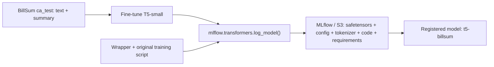

# T5-small / BillSum: Hugging Face training with MLflow

Fine-tune `google-t5/t5-small` to summarize legislation, then save its model,
tokenizer, training code and inferred model dependencies using
`mlflow.transformers.log_model()`. MLflow uploads to its configured S3 artifact
store and registers the model as `t5-billsum`.

The example uses the unchanged official Hugging Face
[`run_summarization.py`](https://github.com/huggingface/transformers/blob/v4.57.1/examples/pytorch/summarization/run_summarization.py)
from Transformers `v4.57.1`. `upstream-info.json` records SHA-256 hashes for the
downloaded script and Apache 2.0 license. `train.py` supplies configuration,
prepares the dataset split, starts that script and handles MLflow logging.

```text
mlflow-t5-billsum/
├── upstream/
│   ├── run_summarization.py  # Original, unchanged training script
│   └── LICENSE
├── upstream-info.json
├── requirements-training.txt
├── train.py
├── workflow.yaml
└── README.md
```



This workflow trains and logs only. It does not call a generator or deploy to
Triton. No `input_example` is supplied and no additional prediction or text
generation runs during logging. The training script evaluates loss after each
epoch; generated-text evaluation is disabled. MLflow may supply a default
signature for the summarization task without executing the model.

## Dataset and configuration

Following the [Hugging Face tutorial](https://huggingface.co/docs/transformers/v4.57.1/en/tasks/summarization),
the wrapper downloads the `ca_test` subset of
[`FiscalNote/billsum`](https://huggingface.co/datasets/FiscalNote/billsum):
1,237 text/summary pairs, about 15 MB of uncompressed text. A seeded 80/20 split
produces 989 training and 248 validation examples. Each epoch processes the
training split. Dataset/model downloads and tokenization happen in the workflow
pod; no dataset upload to S3 is needed.

| Workflow parameter / wrapper argument | Default | Purpose |
| --- | --- | --- |
| `model` / `--model` | `google-t5/t5-small` | Pretrained model to fine-tune |
| `epochs` / `--epochs` | `1` | Training epochs |
| `batch-size` / `--batch-size` | `4` | Training batch size |
| `eval-batch-size` / `--eval-batch-size` | `4` | Validation batch size |
| `learning-rate` / `--learning-rate` | `0.00005` | Optimizer learning rate |
| `max-source-length` / `--max-source-length` | `512` | Input token limit, including `summarize: ` prefix |
| `max-target-length` / `--max-target-length` | `128` | Summary token limit |
| `max-train-samples` / `--max-train-samples` | `0` | Limit training records; 0 uses all 989 |
| `max-eval-samples` / `--max-eval-samples` | `0` | Limit validation records; 0 uses all 248 |
| `device` / `--device` | `cuda` | Execution device |
| `registered-model-name` / `--registered-model-name` | `t5-billsum` | MLflow registry name |

The source limit is 512 tokens to keep the example's training cost modest;
the tutorial uses 1,024. Longer documents and summaries are truncated. Training
uses the `summarize: ` prefix expected by T5. To test only the integration, set
`max-train-samples=32` and `max-eval-samples=8` before using the whole subset.

## Prepare and upload

1. Enable MLflow and Argo Workflows in Triton Control. Configure MLflow with an
   S3 artifact profile.
2. Link an owned S3 profile under **Workflows → Configure S3 Secrets** and put
   its name in annotation `triton-control.ai/mlflow-s3-profile-name`. The running
   backend must support profile injection for training-only workflows.
3. The default workflow uses `nvcr.io/nvidia/tritonserver:26.06-py3` and requests
   one GPU. Provide the NVIDIA device plugin and a compatible driver. The workflow
   installs `torch==2.11.0` and `torchvision==0.26.0` from the official CUDA 13.0
   wheel index because the
   Triton image does not include Python PyTorch. It selects CPU wheels instead
   when `device=cpu`. The workflow selects RuntimeClass `nvidia` through
   `podSpecPatch`; adjust it if your cluster uses another NVIDIA runtime name.
4. Allow network access to PyPI, `download.pytorch.org` (including its wheel-storage
   host), Hugging Face (including model/dataset storage)
   and NLTK's data download endpoint. The unchanged script loads the ROUGE metric
   and downloads NLTK resources even when generated-text evaluation is disabled.
   No Hugging Face account or Hub publication is required for this public model.

From the Triton Control repository root, create the source archive:

```bash
tar -czf /tmp/t5-billsum-source.tar.gz \
  -C examples/workflows/mlflow-t5-billsum \
  train.py upstream upstream-info.json requirements-training.txt README.md
```

Upload it through Code-Server's S3 Operations to
`workflows/mlflow-t5-billsum/source.tar.gz` in your linked profile's bucket.
Include any profile prefix in `s3-source-key`. The archive must contain `train.py`
and `upstream/` at its root; Argo extracts it into `/workspace/source`.

## Run

1. Edit `workflow.yaml`: set an unused `metadata.name`, your S3 profile name,
   the source archive key and the desired training parameters.
2. Open **Workflows → Submit New Workflow**, upload or paste the edited YAML,
   and submit it.
3. Follow the **train** node's logs until it succeeds. The node returns the
   saved `models:/<model-id>` URI as its `mlflow-model-uri` output parameter.

Triton Control injects tracking credentials and the run creator identity. MLflow
handles the model upload; there is no additional Argo model-output upload.

For CPU execution, set `device=cpu` and remove `nvidia.com/gpu` from the container
resource limits and the NVIDIA `podSpecPatch`. The workflow selects the CPU PyTorch installation index
automatically. Use a fresh `--work-dir` for each
local run to avoid unintentionally reusing an earlier checkpoint.

Local invocation in a writable Python environment:

```bash
python -m pip install "torch==2.11.0" "torchvision==0.26.0" --index-url https://download.pytorch.org/whl/cu130
python -m pip install -r requirements-training.txt
python train.py --epochs 1 --batch-size 4 --device cuda
```

Set `MLFLOW_TRACKING_URI` and your normal tracking authentication first.
Transformers is pinned to `4.57.1` to match the upstream script and retain the
summarization pipeline used by this example. The workflow installs these packages
into `/tmp/training-env`, a virtual environment with access to system packages.
It bootstraps the environment through the image's pip, without requiring ensurepip.

## Inspect in MLflow

Open experiment **t5-billsum**:

- The run records training parameters and the upstream `train_*` / `eval_*`
  metrics, including losses. ROUGE is not computed in this configuration.
- Logged Model **transformers-checkpoint** contains Hugging Face weights
  (`model.safetensors`, possibly sharded), model configuration, tokenizer files,
  copied source under `code/`, `MLmodel`, `requirements.txt`, `conda.yaml` and
  `python_env.yaml`. These are stored under MLflow's configured S3 artifact root.
- Model Registry **t5-billsum** has a version referencing that Logged Model.
- Run artifacts under `provenance/` contain the upstream hashes and
  `requirements-training.txt` used to install training tools.

The saved model uses the Hugging Face Transformers flavor, not a pickled PyTorch
model. MLflow automatically determines its model requirements because no
`pip_requirements` or environment override is passed. The training requirements
file is separate and does not replace the model's inferred `requirements.txt`.
MLflow's default PyTorch-backed Transformers requirements include `torchvision`,
even for this text model, so the workflow installs it together with matching torch.
The wrapper imports torchvision before training starts and records both package
versions, so missing or incompatible torchvision fails before the training run.
Without a prediction example, inference-only imports may not be observed; failed
dependency inference falls back to MLflow's default Transformers requirements.
The PyTorch wheel comes from the official CPU or cu130 index; reinstalling the
captured model environment may require that index as well. The run records the
training-image identity.

Load the components later using the corresponding registered model version:

```python
components = mlflow.transformers.load_model(
    "models:/t5-billsum/1", return_type="components"
)
model = components["model"]
tokenizer = components["tokenizer"]
```

This is an independent example of a standard T5 model. It does not establish
support for custom model classes or custom pointer mechanisms in the future
generator.
