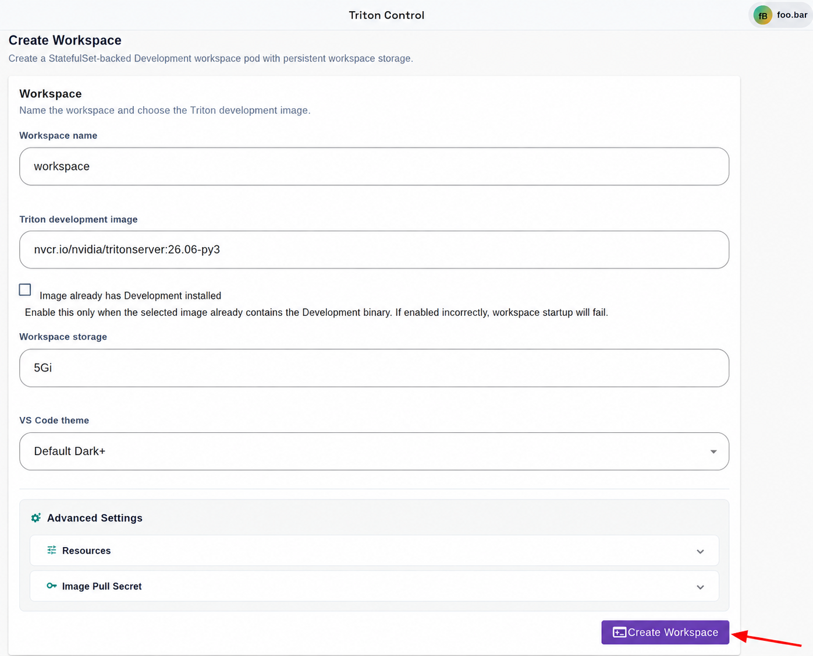
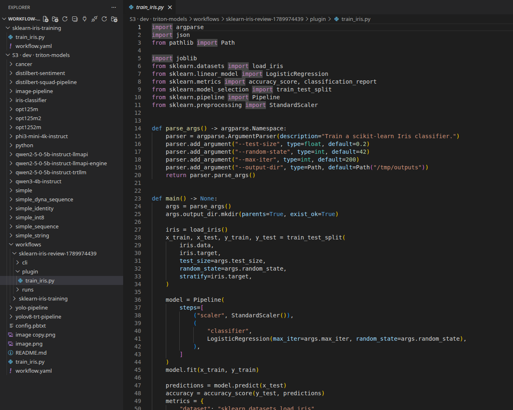
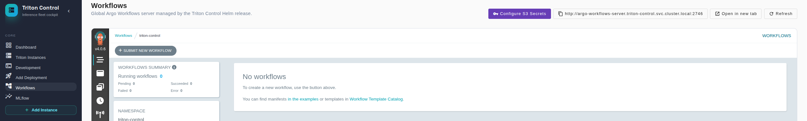
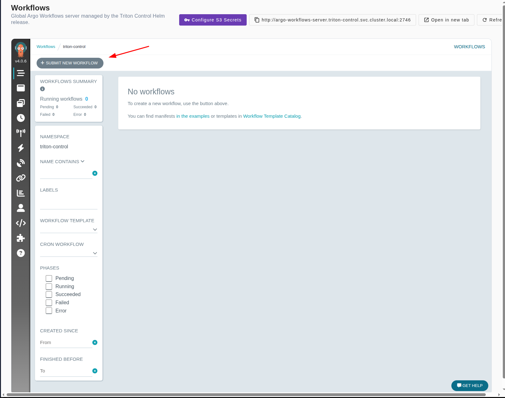
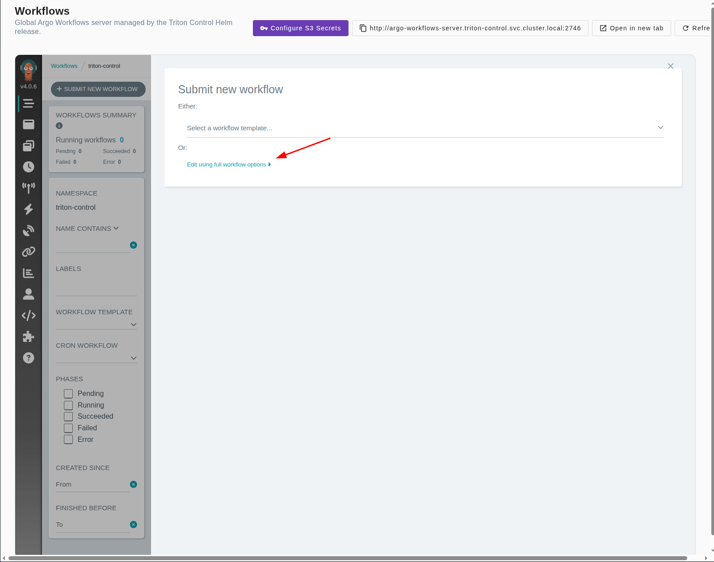
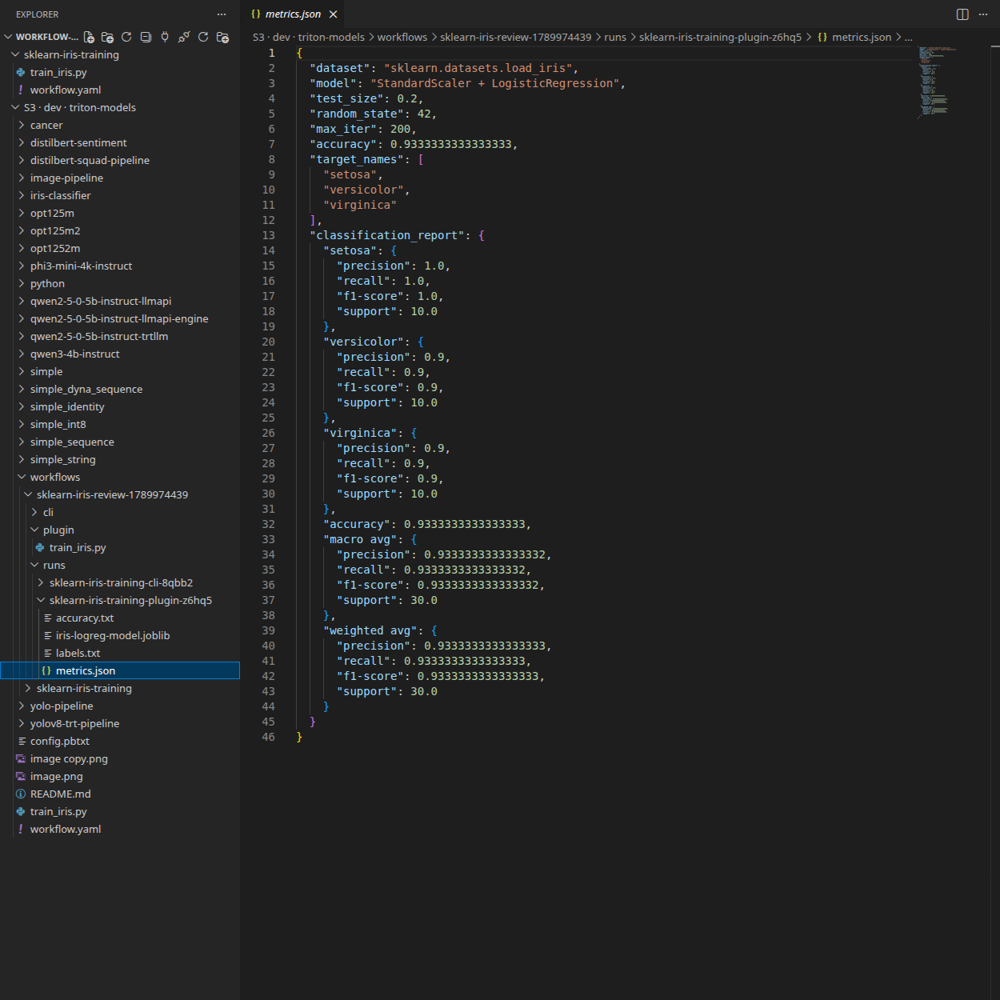
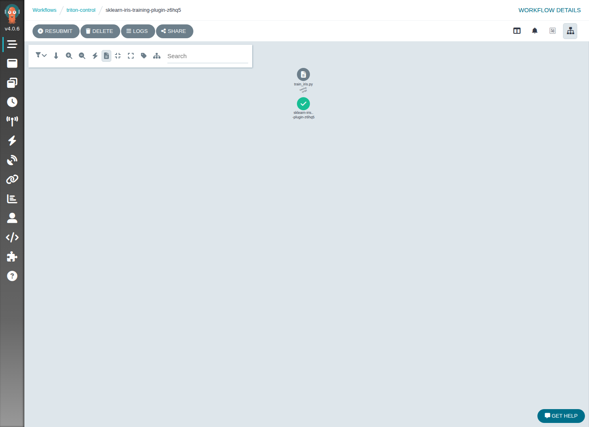

# scikit-learn Iris Training Workflow

This example follows a small data-science loop in Triton Control: develop a
training script in a Development workspace, upload it to S3-compatible object
storage, then run it as an Argo Workflow. The workflow downloads the script,
trains an Iris classifier, and stores the model and evaluation results back in
the object store.


## Prerequisites

- Argo Workflows is enabled in Triton Control.
- You have an existing S3-compatible bucket and a saved profile under the Triton
  Control account menu's **S3 Profiles**. Use the same account for the workspace
  and workflow profile link.
- The profile's credentials allow listing the bucket, reading the training script,
  and writing the script and run outputs. The endpoint must be reachable from
  both the workspace and workflow pods. For HTTPS with a custom CA, include the
  public CA certificate in the saved profile.


## 1. Create a Development Workspace

In Triton Control, open **Development** and create a CPU-only workspace for
writing and testing the training code:

| Field | Value |
| --- | --- |
| Triton development image | `nvcr.io/nvidia/tritonserver:26.06-py3` |
| Image already has Development installed | Disabled |
| Workspace storage | At least `5Gi` |
| GPU count | `0` |

When the workspace is ready, open code-server from **Development**. Triton
Control installs the Development runtime because the Python image does not
include code-server. It also installs the **Triton Control Deploy** plugin, whose
S3 browser appears alongside the workspace folders in **Explorer**.



## 2. Create the Training Code in the Workspace

In the workspace, create a directory for the example: `/workspace/sklearn-iris-training`

Then copy or upload `train_iris.py` and `workflow.yaml` from this example into
that directory. `train_iris.py` is the training code that the workflow will execute. It trains
a `StandardScaler` plus `LogisticRegression` pipeline on
`sklearn.datasets.load_iris` and writes the training results to its output
directory.


Edit the script in the workspace to try a different model, feature processing,
or training arguments. Keep the output files, or update the validation and
artifact expectations in `workflow.yaml` to match your own script.

## 3. Upload the Training Script

Upload `train_iris.py` using either option below. Use the same bucket and saved
Triton Control S3 profile that you will link in step 4.

### Code-Server S3 Plugin

1. In code-server's **Explorer**, right-click the workspace folder and select
   **S3 Operations → Choose Profile…** (or **Switch Profile…**), then choose your
   saved S3 profile.
2. Expand **S3 · <profile name> · <bucket>**. If it shows **Buckets**, open your
   profile's configured bucket first. Create or open `workflows/sklearn-iris-training/`.
3. Drag the local `train_iris.py` onto that S3 folder and wait for the upload.
   This copies the file; the workspace source stays in place.



### AWS CLI

In the workspace terminal, install AWS CLI and configure credentials for the
same endpoint and bucket. AWS CLI does not load Triton Control profiles.

```bash
python3 -m pip install --user awscli
export PATH="$(python3 -m site --user-base)/bin:$PATH"
aws configure --profile workflow-training
cd /workspace/sklearn-iris-training
aws --profile workflow-training \
  --endpoint-url https://<your-s3-endpoint> \
  s3 cp train_iris.py \
  s3://<your-s3-bucket>/workflows/sklearn-iris-training/train_iris.py
```

If required by your provider, set addressing style with
`aws configure set s3.addressing_style path --profile workflow-training`
(use `virtual` for virtual-hosted addressing). For a custom HTTPS CA, set
`AWS_CA_BUNDLE` to your CA certificate file before uploading.

For either option, use the full uploaded object key in step 5. With no profile
prefix, it is `workflows/sklearn-iris-training/train_iris.py`. With a prefix such
as `team-a`, include it in the CLI destination and both workflow object paths:
`team-a/workflows/sklearn-iris-training/train_iris.py`. The plugin's S3 root
already starts at the profile prefix.

## 4. Link the S3 Profile

In the **Triton Control UI**, select **Workflows** in the left sidebar, then
click **Configure S3 Secrets** at the top right, as shown below.



In the dialog, select the Triton Control S3 profile
for the endpoint and bucket used in step 3, then click **Link profile**. If you
used the code-server plugin, select the same profile. AWS CLI profiles are
configured separately and are not linked automatically.

Triton Control creates a Secret and an Argo repository ConfigMap in the workflow
namespace. Endpoint, bucket, region, credentials, and the optional
HTTPS CA certificate sync automatically when the profile is saved. The ConfigMap
stores connection settings; the Secret stores credentials and the CA certificate.

For an existing link, click **Sync now** once after upgrading to create its repository.
The dialog shows sync errors and lets the profile owner retry. Remove the link before
deleting its source profile. New runs use updated settings; running workflows may
retain previously loaded values.

## 5. Configure the Workflow in code-server

In your **Development workspace**, open **code-server** and edit
`/workspace/sklearn-iris-training/workflow.yaml`.

Set these values under `spec.arguments.parameters`:

| Parameter | Value |
| --- | --- |
| `s3-script-key` | Full S3 key of the script uploaded in step 3, e.g. `workflows/sklearn-iris-training/train_iris.py` |
| `s3-output-prefix` | S3 folder for results, e.g. `workflows/sklearn-iris-training/runs` |

If your profile uses a prefix such as `team-a`, include `team-a/` at the start
of both values.

**One linked S3 profile:** Triton Control uses it automatically.

**More than one linked S3 profile:** add this annotation to the existing
`metadata` block. Replace `workflow-training` with the saved profile name you
linked in step 4:

```yaml
metadata:
  annotations:
    triton-control.ai/mlflow-s3-profile-name: workflow-training
```

Save the file. Triton Control supplies the S3 connection settings when you
submit it in step 6.

## 6. Submit the Workflow

Open **Triton Control → Workflows**, then in the embedded Argo UI:

1. Select **Submit New Workflow**.
2. Select **Edit using full workflow options**.
3. Paste the configured contents of `workflow.yaml`, or use **Upload File**
   to select the configured manifest from your computer.
4. Create the workflow.





Before the training container starts, the Argo executor downloads
`s3-script-key` to `/tmp/train_iris.py`. The container installs the pinned
Python packages and writes all training results to `/tmp/outputs`. After the
container exits, the executor uploads that directory to S3. A missing source
object, invalid credentials, or a failed upload makes the Workflow fail.

## 7. Check the Outputs

Outputs are stored at `s3://<bucketname>/<s3-output-prefix>/<workflow-name>/`.
`<bucketname>` comes from the linked S3 profile. With the default output prefix:

```text
s3://<bucketname>/workflows/sklearn-iris-training/runs/
`-- sklearn-iris-training-abc12/
    |-- accuracy.txt
    |-- iris-logreg-model.joblib
    |-- labels.txt
    `-- metrics.json
```

Use either method from step 3 to inspect the results.

### AWS CLI

Use the same profile, endpoint, and custom CA setting from step 3. Replace the
placeholders with your bucket, output prefix, and actual Argo Workflow name:

```bash
aws --profile workflow-training \
  --endpoint-url "https://<your-s3-endpoint>" \
  s3 ls "s3://<bucketname>/<s3-output-prefix>/<workflow-name>/" --recursive
```

Print the evaluation metrics:

```bash
aws --profile workflow-training \
  --endpoint-url "https://<your-s3-endpoint>" \
  s3 cp "s3://<bucketname>/<s3-output-prefix>/<workflow-name>/metrics.json" -
```

Include any browsing prefix in `<s3-output-prefix>`, just as you did in
`workflow.yaml`.

### Code-Server S3 Plugin

In code-server's **Explorer**, use **S3 Operations → Refresh** on the connected
S3 root to load the results written by Argo. Expand
`workflows/sklearn-iris-training/runs/<workflow-name>/` beneath the same profile
root used in step 3. This relative path also applies to the `team-a` example
when you included that prefix in both workflow parameters.

Check that all four files shown above exist. Open `metrics.json` and
`accuracy.txt` directly from the S3 tree to inspect the results. To keep a local
copy of the run, drag its folder from S3 onto `/workspace/sklearn-iris-training/`
in Explorer. The default S3-to-workspace drag copies the results and leaves
the S3 originals in place.



The Argo Workflow also exposes `accuracy` as an output parameter and records
the S3 location as the `training-results` output artifact.


